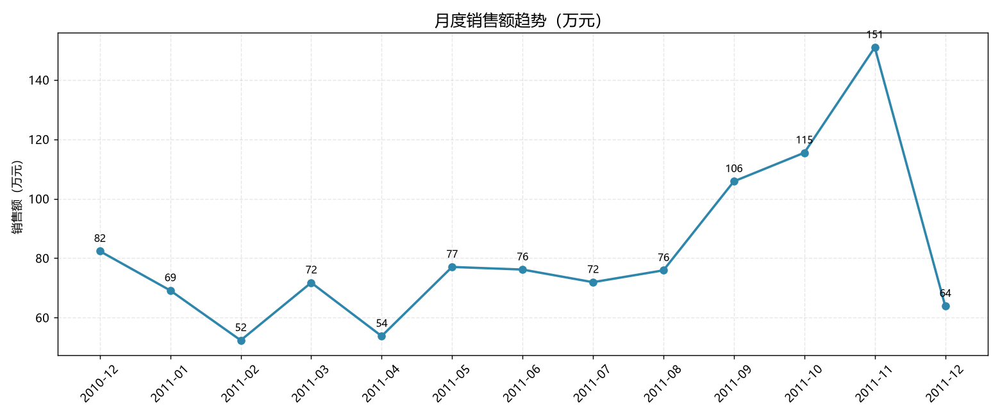
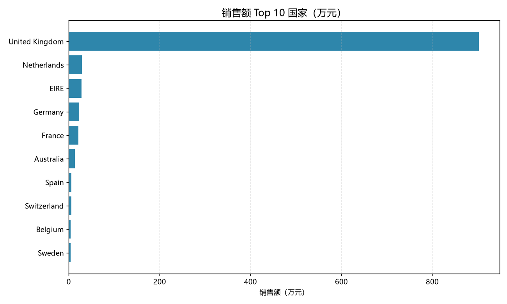
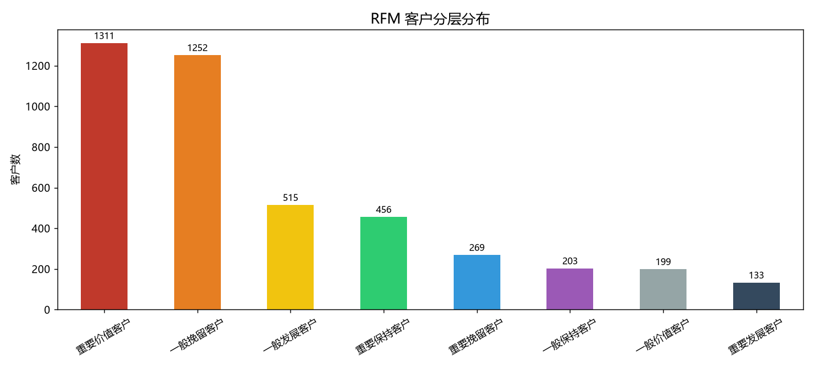
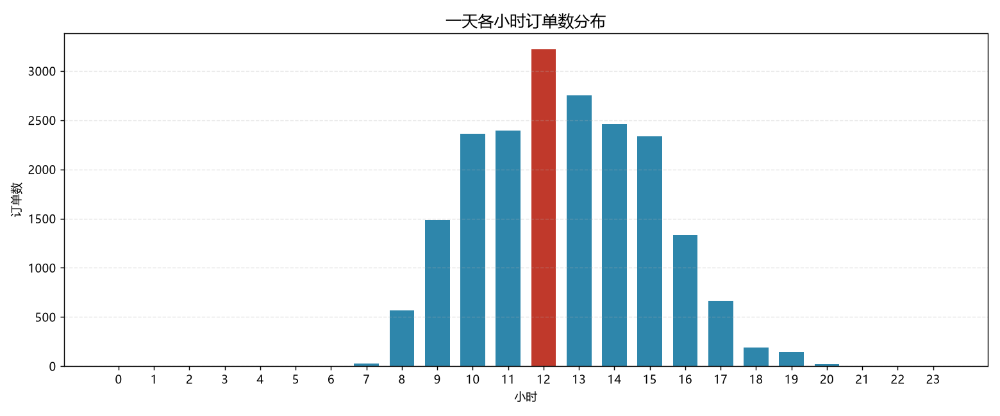

# 在线零售销售与客户分析（Online Retail Analysis）

基于 UCI 公开数据集 **Online Retail**（541,909 行真实交易记录，2010-12 ~ 2011-12）的完整数据分析项目。

## 核心结论

- 英国本土市场贡献 **84.6%** 销售额，存在单一市场依赖风险
- 销售呈明显圣诞季节性，**11 月达峰（150.9 万元）**
- **34.4%** 的客户只购买一次；**28.9%** 的客户平均 193 天未回购
- 发票维度取消率 **14.81%**

## 分析内容

| 模块 | 内容 |
|---|---|
| 数据清洗 | 取消单、负数量、零单价、缺失客户 ID 的处理与口径定义 |
| 销售分析 | 总体指标、月度趋势、国家分布、商品 Top 10 |
| 客户分析 | 一次性客户占比、RFM 八分层与业务解读 |
| 运营分析 | 下单时段、星期效应、取消率与取消商品 |

## 图表

| 月度趋势 | 国家分布 |
|---|---|
|  |  |

| RFM 分层 | 时段分布 |
|---|---|
|  |  |

## 项目结构

```
online-retail-analysis/
├── README.md
├── report.md              # 完整分析报告（结论 + 建议 + 局限）
├── analysis.ipynb         # 分析代码
├── requirements.txt
├── charts/                # 6 张图表
└── data/README.md         # 数据来源与下载说明
```

## 数据

数据不随仓库提供（46 MB）。下载地址与字段说明见 [data/README.md](data/README.md)。

## 运行

```bash
pip install -r requirements.txt
jupyter notebook analysis.ipynb
```

> 修改 notebook 中的 `DATA_PATH` 指向你本地的 `online_retail.csv`，然后 `Kernel → Restart & Run All`。

## 技术栈

Python · pandas · matplotlib · Jupyter
