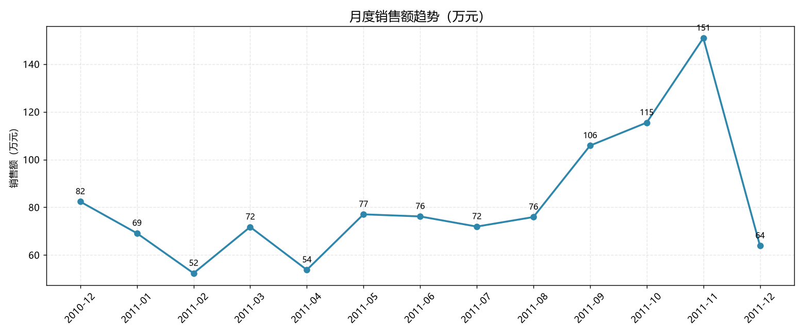
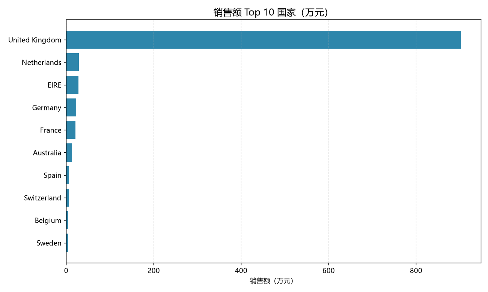
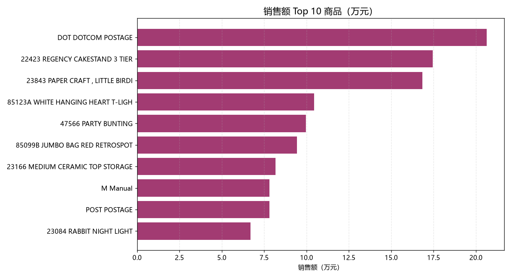
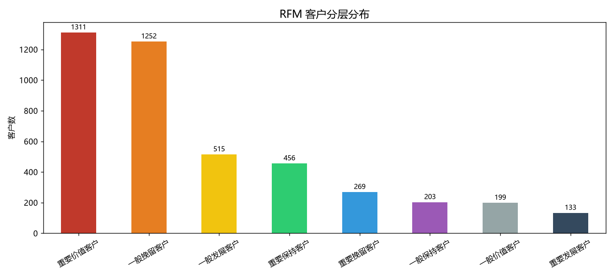
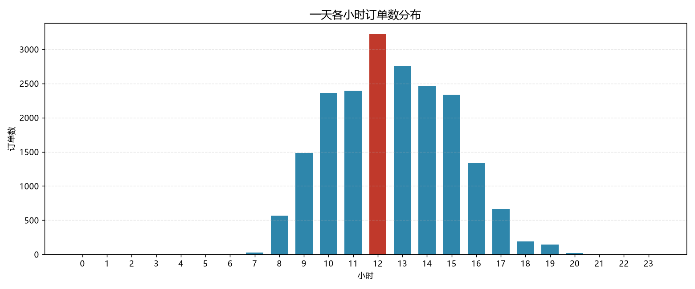
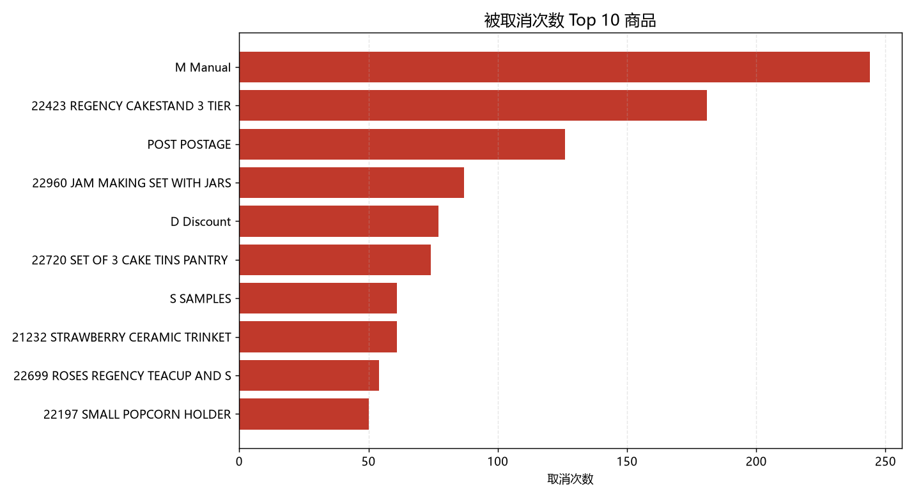

# 英国在线零售商销售与客户分析报告

**数据周期**：2010-12-01 ~ 2011-12-09　|　**数据规模**：541,909 行 / 25,900 张发票 / 4,372 位客户

---

## 一、核心结论

1. **业务高度依赖英国本土市场**：英国贡献 902.5 万元，占总销售额的 **84.6%**，其余 37 个国家合计不足 16%，存在单一市场风险。
2. **销售呈明显圣诞季节性**：9→11 月销售额从 105.9 万升至 150.9 万，11 月达全年峰值；12 月仅 63.9 万，系数据截止至 12 月 9 日，**不代表业务下滑**。
3. **客户结构两极分化**：30.2% 的"重要价值客户"贡献高频高额消费（平均 9.4 次、人均 4,948 元）；同时 **28.9% 的客户已流失**（平均 193 天未购买、仅消费 286 元）。
4. **首单后流失是最大短板**：34.4% 的客户只购买过一次；其中"只买一次且金额偏低"的客户占全部客户的 19.8%。

---

## 二、数据说明与口径

### 2.1 数据来源
UCI Machine Learning Repository — Online Retail Dataset（英国在线零售商真实交易记录）。

### 2.2 口径定义

| 口径 | 规则 | 用途 |
|---|---|---|
| **销售口径（基础清洗）** | 排除 InvoiceNo 以 `C` 开头的取消单；排除 `Quantity <= 0`；排除 `UnitPrice <= 0` | 所有销售/商品/趋势分析 |
| **客户口径** | 在销售口径基础上，额外排除 `CustomerID` 缺失的行 | 客户/RFM 分析 |

### 2.3 清洗影响

| 阶段 | 行数 | 销售额 |
|---|---|---|
| 原始数据 | 541,909 | 974.8 万（含退货负数，为**净额**） |
| 销售口径 | 530,104 | **1,066.7 万** |
| 客户口径 | 397,884 | 891.1 万 |

> ⚠️ **原始数据的"销售额"低于清洗后**，因为取消单与退货金额为负。直接使用原始总额会低估真实销售 91.9 万元。
> ⚠️ 25% 的订单无 `CustomerID`（游客单），它们贡献了约 16.4% 销售额，做客户分析时被迫剔除。

---

## 三、销售表现

### 3.1 总体指标

| 指标 | 数值 |
|---|---|
| 有效销售额 | 10,666,684.54 |
| 有效订单（发票）数 | 19,960 |
| 客单价（AOV） | **534.4 元** |
| 有 ID 客户数 | 4,338 |
| 在售商品数（StockCode） | 3,922 |
| 覆盖国家 | 38 |

### 3.2 月度趋势



| 月份 | 销售额（万元） |
|---|---|
| 2010-12 | 82.4 |
| 2011-09 | 105.9 |
| 2011-10 | 115.5 |
| **2011-11** | **150.9** |
| 2011-12 | 63.9（仅 9 天数据） |

**解读**：9 月起销售额连续三个月爬升，11 月达到峰值，符合**圣诞礼品采购季**特征。建议将备货、客服与物流资源向 9-11 月集中。

### 3.3 国家分布



| 国家 | 销售额（万元） | 占比 |
|---|---|---|
| United Kingdom | 902.5 | 84.6% |
| Netherlands | 28.5 | 2.7% |
| EIRE | 28.3 | 2.7% |
| Germany | 22.9 | 2.1% |
| France | 21.0 | 2.0% |

**解读**：本土市场占比 84.6%，海外市场分散且单个体量小。**单一市场依赖度高**，若英国市场波动，整体营收缺乏缓冲。

### 3.4 商品表现与数据陷阱



| 排名 | 编码 | 商品 | 销售额（万元） |
|---|---|---|---|
| 1 | DOT | DOTCOM POSTAGE | 20.6 |
| 2 | 22423 | REGENCY CAKESTAND 3 TIER | 17.4 |
| 3 | 23843 | PAPER CRAFT, LITTLE BIRDIE | 16.8 |
| 4 | 85123A | WHITE HANGING HEART T-LIGHT HOLDER | 10.5 |

> ⚠️ **重要发现**：销售额榜首的 `DOT`（邮费）、`M`（Manual 手工调整）、`POST`（Postage 邮费）**并非真实商品**，而是附加费用/调整项。直接按 StockCode 排名会污染商品榜。
>
> **剔除这些非商品编码后，真实商品第一名为 `22423 REGENCY CAKESTAND 3 TIER`（17.4 万元）。**

---

## 四、客户分析

### 4.1 一次性购买客户

| 指标 | 数值 |
|---|---|
| 有 ID 客户数 | 4,338 |
| 只买过一次的客户 | 1,493 |
| 占比 | **34.4%** |
| 只买一次且金额低于下四分位（307 元） | 860（占全部 19.8%，占单次客户 57.6%） |

**解读**：超过三分之一的客户首单后未再复购，且其中近六成消费金额偏低。**首单转化做得不错，但留存是明显短板。**

### 4.2 RFM 客户分层



| 客户分层 | 人数 | 占比 | 平均 R（天） | 平均 F（次） | 平均 M（元） |
|---|---|---|---|---|---|
| 重要价值客户 | 1,311 | 30.2% | 16.9 | 9.4 | 4,948 |
| **一般挽留客户** | **1,252** | **28.9%** | **193.3** | **1.2** | **286** |
| 一般发展客户 | 515 | 11.9% | 25.1 | 1.4 | 313 |
| 重要保持客户 | 456 | 10.5% | 105.1 | 4.7 | 2,142 |
| 重要挽留客户 | 269 | 6.2% | 146.7 | 1.6 | 1,561 |
| 一般保持客户 | 203 | 4.7% | 146.5 | 3.0 | 424 |
| 一般价值客户 | 199 | 4.6% | 21.2 | 3.1 | 464 |
| 重要发展客户 | 133 | 3.1% | 22.6 | 1.8 | 2,479 |

### 4.3 RFM 业务解读

**① 核心盘稳固**
"重要价值客户"1,311 人（30.2%），平均 17 天内有购买、累计 9.4 次、人均 4,948 元——这批人是营收主力，应重点维护。

**② 最大风险：1,252 人已流失**
"一般挽留客户"占 28.9%，平均 **193 天**未购买、仅买过 1.2 次、人均消费 286 元。这批人基本是"买一次就走"，**需要召回策略**。

**③ 最值得投入：133 人高潜客户**
"重要发展客户"仅 133 人，但平均消费 2,479 元、最近 22.6 天有购买、购买次数只有 1.8 次——**高频高价值但买得少**，提升购买频次的回报最高。

---

## 五、运营发现

### 5.1 下单时段



| 时段 | 订单占比 |
|---|---|
| 10:00-15:00 | 主要集中区间 |
| **12:00** | **峰值（3,220 单）** |
| 18:00 后 | 快速下降 |

**建议**：客服、审单、发货排班应与 10:00-15:00 高峰对齐。

### 5.2 星期效应

| 星期 | 订单数 |
|---|---|
| 周一 | 3,126 |
| 周二 | 3,554 |
| 周三 | 3,690 |
| **周四** | **4,246** |
| 周五 | 3,140 |
| **周六** | **0** |
| 周日 | 2,204 |

**解读**：周四订单最集中；**周六订单为 0**，说明该商家周末不处理订单（或系统不记录），属业务特征而非数据缺失。

### 5.3 取消分析

| 指标 | 数值 |
|---|---|
| 总发票数 | 25,900 |
| 取消发票数（C 开头） | 3,836 |
| **发票维度取消率** | **14.81%** |
| 行维度取消率 | 1.71% |



| 编码 | 名称 | 取消次数 |
|---|---|---|
| M | Manual（手工调整） | 244 |
| 22423 | REGENCY CAKESTAND 3 TIER | 181 |
| POST | POSTAGE（邮费） | 126 |
| 22960 | JAM MAKING SET WITH JARS | 87 |
| D | Discount（折扣） | 77 |

> ⚠️ 取消榜前列同样混入 `M`、`POST`、`D`、`S` 等**非商品编码**。剔除后，真实商品中取消最多的是 **REGENCY CAKESTAND 3 TIER（181 次）**。

---

## 六、问题与建议

| # | 问题 | 建议 |
|---|---|---|
| 1 | 34.4% 客户只买一次 | 首单后 7/30 天自动触达（邮件/优惠券）；建立首单转化到复购的运营链路 |
| 2 | 1,252 名客户平均 193 天未回购 | 针对"一般挽留客户"做定向召回，优先高 M 的"重要挽留客户"（269 人，人均 1,561 元） |
| 3 | 英国市场占比 84.6% | 评估 Netherlands / EIRE / Germany 三个市场的增长空间，降低单一市场风险 |
| 4 | 取消率 14.81% | 先剔除 M/POST/D 等非商品行再统计；重点核查 REGENCY CAKESTAND 的取消原因 |
| 5 | 商品榜被邮费/调整项污染 | 建立"非商品编码黑名单"（M、POST、DOT、D、S、BANK CHARGES 等），所有商品分析前先剔除 |

---

## 七、局限说明

1. **无用户行为数据**（浏览、加购、收藏），无法分析转化漏斗，也无法判断流失原因。
2. **无退货/取消原因字段**，取消率偏高只能定位到商品，无法定位原因。
3. **25% 订单无 CustomerID**，客户分析被迫剔除这部分（约占销售额 16.4%），可能造成客户画像偏差。
4. **数据仅覆盖约 1 年**，无法做同比分析；12 月数据不完整（仅 9 天）。
5. RFM 分层采用**四分位打分 + 均值划分**，阈值带有主观性，换用其他阈值会得到不同分层结果。

---

## 附：项目结构

```
online-retail-analysis/
├── README.md              # 项目说明
├── report.md              # 本报告
├── analysis.ipynb         # 完整分析代码
├── requirements.txt
├── charts/                # 图表
└── data/README.md         # 数据来源说明
```
